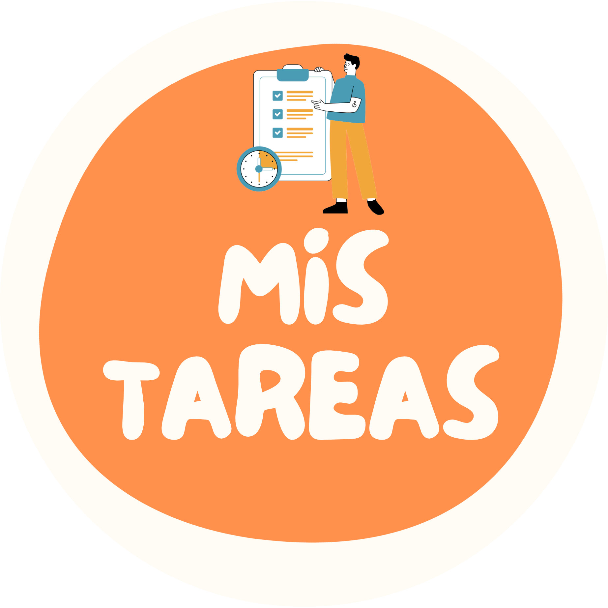

<p align="center">
  
</p>

<h1 align="center">Mis Tareas</h1>

<p align="center">
  Listas y recados para Android: sencilla como una lista de la compra, sincronizada con Nextcloud Tasks o con archivos Markdown en tu propio servidor.
</p>

<p align="center">
  <a href="LICENSE"></a>
  
</p>

---

Los clientes CalDAV completos (como Tasks.org) son estupendos, pero abruman a quien solo quiere apuntar la compra o cuatro cosas para hoy. Mis Tareas va al grano: abres una lista, escribes y pulsas Intro. Sin submenús. Por debajo habla el estándar CalDAV con Nextcloud Tasks o guarda cada lista como un archivo `.md` legible en cualquier carpeta WebDAV.

## Características

- **Local primero**: funciona sin conexión y sin cuenta. La sincronización es opcional.
- **Entrada rápida**: escribe y pulsa Intro; el teclado sigue abierto para la siguiente tarea. Si pegas varias líneas (una receta, una lista de WhatsApp…), se crea una tarea por línea, sin viñetas ni casillas.
- **Entrada inteligente** (desactivable): «Pagar alquiler el viernes !» crea la tarea *Pagar alquiler*, para el viernes y marcada como importante; «Llamar a Ana mañana a las 17» además pone un recordatorio. Entiende fechas y horas en los 5 idiomas (*mañana, demain, morgen, domani; a las 9, at 6pm, à 18h, um 9 Uhr, alle 21:15; 15/11, 15.11.*) y muestra lo que ha entendido antes de añadir (con una ✕ para ignorarlo).
- **Subtareas**: desde el detalle de una tarea se añaden, marcan y abren sus subtareas; en la lista aparecen sangradas bajo su tarea, con un contador «2/5». Completar o borrar una tarea hace lo mismo con sus subtareas, y moverla de lista se las lleva. En CalDAV son `RELATED-TO` (las que crean Nextcloud Tasks, Tasks.org o Thunderbird) y en Markdown, tareas sangradas.
- **Etiquetas**: se ponen en el detalle (con sugerencias de las ya usadas) o escribiendo `#casa` en la entrada rápida; se ven en la lista y la búsqueda las encuentra. Son `CATEGORIES` en CalDAV y `#etiquetas` de Obsidian en Markdown.
- **Tareas que se repiten**: cada día, semana, mes o año (y cualquier regla RRULE creada en otra app, como «el último viernes de cada mes»). Al completarla pasa sola a la siguiente fecha y su aviso se mueve con ella (con «Deshacer» por si fue sin querer). En la entrada rápida basta con escribir «cada lunes», «todos los días», «every week», «tous les mois», «jeden Montag» u «ogni anno». Se sincroniza como `RRULE` en CalDAV y como `🔁 every week` (plugin Tasks de Obsidian) en Markdown.
- **Fecha límite con hora** y aviso a esa hora aunque la tarea no tenga recordatorio (desactivable).
- **Resumen diario** a la hora que elijas (por defecto 9:00) con las tareas de hoy y las vencidas; al tocarlo se abre «Hoy».
- **Recordatorios** con notificación y botones «Hecha», «10 min» y «Posponer 1 h». Los que tocaban con el móvil apagado se muestran al encenderlo, y se reprograman al cambiar la hora o la zona horaria. Atajos «Dentro de 1 h», «Mañana 9:00» o fecha y hora a elegir. Se sincronizan: en Nextcloud como alarma del VTODO (la que muestra Nextcloud Tasks) y en Markdown como `⏰ 2026-11-10 09:00` (plugin Reminder de Obsidian). Sobreviven a reinicios del móvil.
- **Compra por secciones del súper**: con el orden «Secciones del súper» los productos se agrupan solos (🥦 Frutas y verduras, 🥛 Lácteos y huevos, 🥤 Bebidas, 🧽 Limpieza…) en el orden habitual de recorrido de la tienda, con un diccionario en los 5 idiomas que entiende plurales y compuestos alemanes. Si un producto cae en la sección equivocada, se cambia en su detalle y la app lo **aprende** para la próxima vez. Las listas llamadas «Compra», «Shopping», «Courses», «Einkauf» o «Spesa» lo traen activado.
- **Listas con color** e icono automático según el nombre (Compra → carrito, Casa → casa…).
- **Vistas «Hoy» e «Importantes»** con las tareas de todas las listas, incluidas las vencidas.
- **Gestos**: marcar con un toque (con animación antes de pasar a «Completadas»), deslizar para borrar con **Deshacer**, mantener pulsado y arrastrar para reordenar.
- **Orden** manual, por fecha límite o alfabético, y **«Borrar completadas»** de un toque (ideal al volver del súper).
- **Listas compartidas** (modo Nextcloud Tasks): desde «Compartir» buscas personas o grupos de tu Nextcloud y eliges si pueden editar o solo ver. La lista les aparece sola en su Mis Tareas (y en Nextcloud Tasks) con «Compartida por…»; con la app abierta se sincroniza cada minuto, así que lo que tache la otra persona en el súper lo ves enseguida. Quien la recibe puede dejar de verla sin borrarla para nadie.
- **Detalle de tarea**: notas, fecha límite (Hoy, Mañana, Próxima semana o calendario), importante y mover a otra lista.
- **Compartir**: envía una lista como texto a cualquier app, o comparte texto *hacia* Mis Tareas para añadirlo a la lista que elijas. Acceso directo «Nueva tarea» manteniendo pulsado el icono.
- **Búsqueda** en todas las listas.
- **Diseño de la familia Mis Apps** (compartido con Mis Podcast y Mis Notas): tipografías Outfit e Inter, naranja del logo como color principal, tema claro, oscuro o del sistema con negro puro AMOLED, icono temático en Android 13+.
- **Español, inglés, francés, alemán e italiano**: se elige en Ajustes (o «Idioma del sistema»). En Android 13+ también desde los ajustes de idioma del sistema.
- Sin anuncios, sin rastreadores, sin servicios de Google.

## Sincronización

En **Ajustes → Sincronización** elige uno de los dos modos. En ambos se usa una **contraseña de aplicación** (en Nextcloud: *Ajustes personales → Seguridad → Dispositivos y sesiones*), que se guarda cifrada con el Keystore de Android.

### Nextcloud Tasks (CalDAV)

Cada lista es un calendario de tareas y cada tarea un `VTODO`. Lo que hagas en el móvil aparece en la app Tasks de Nextcloud, en Thunderbird, en Recordatorios de Apple o en Tasks.org, y al revés.

- Basta con la dirección del servidor: la app encuentra sola los calendarios (ruta de Nextcloud, `/.well-known/caldav` o descubrimiento estándar), así que también funciona con Radicale, Baïkal, Fastmail, etc.
- Solo se muestran los calendarios que admiten tareas. Crear, renombrar o borrar una lista crea, renombra o borra el calendario.
- **No se pierde nada de otras apps**: al guardar una tarea solo se modifican las propiedades que la app gestiona (título, notas, estado, fecha límite, prioridad, repetición y orden). Etiquetas, subtareas, avisos, ubicación, etc. se conservan intactos. Si cambia la fecha límite, la fecha de inicio (`DTSTART`) se mueve con ella para que el VTODO siga siendo válido, y los avisos relativos («15 min antes») se recalculan.
- Autenticación Basic y **Digest** (la que usa Baïkal por defecto).
- Eficiente: con el CTag del calendario no se descarga nada si no hubo cambios; si el servidor admite `sync-collection` (RFC 6578, como Nextcloud, Radicale o Baïkal) solo se pregunta por lo que cambió desde la última vez, y si no, se comparan los ETags y solo se bajan los `.ics` que cambiaron.
- Los borrados usan `If-Match`: si otro dispositivo modificó la tarea después de que el móvil la viera, no se borra y vuelve con esos cambios.

### Archivos Markdown (WebDAV)

Cada lista es un archivo de texto en una carpeta (por defecto `MisTareas`) de cualquier servidor WebDAV. Con Nextcloud u ownCloud basta con la dirección del servidor; con otros servidores, pon la URL WebDAV completa.

```markdown
---
color: green
---

# Compra

- [ ] Leche ⏫ 📅 2026-11-10 ⏰ 2026-11-10 09:00 🆔 k3j9x0a2qe4m
    Sin lactosa
- [ ] Pan 🆔 a81bd0c4f2x7
- [x] Huevos ✅ 2026-11-09 🆔 p0q8w7e6r5t4
```

- Es el formato del plugin **Tasks de Obsidian**: puedes abrir la carpeta en Obsidian, Nextcloud Text o cualquier editor.
- Las líneas que escribas a mano (sin `🆔`) se convierten en tareas y reciben su identificador en la siguiente sincronización. Los párrafos y propiedades que no son tareas se respetan.
- Si un archivo cambió en el servidor y también en el móvil, se fusionan **tarea a tarea**: las tareas que tocaste en el móvil conservan tus cambios, el resto recibe los del servidor, y nunca se sobrescribe un archivo sin haber visto su última versión (`If-Match`).

### Cuándo se sincroniza

Al abrir la app, un par de segundos después de cada cambio (agrupando cambios seguidos), cada ~30 minutos en segundo plano y en cuanto vuelve la conexión si falló por falta de red.

### Avisos a la hora exacta

En Android 13 o superior la app usa el permiso `USE_EXACT_ALARM`, que se concede al instalar. Google Play solo lo permite en apps cuyo fin principal sean alarmas o calendario; si se publica allí y lo rechazan, basta con quitar esa línea del `AndroidManifest.xml` y la app pedirá «Alarmas y recordatorios» desde Ajustes como en Android 12.

## Compilar

Requisitos: JDK 21 y el SDK de Android.

```bash
./gradlew assembleDebug        # APK de depuración
./gradlew testDebugUnitTest    # tests (Markdown, iCalendar y alarmas, fusión, entrada inteligente, secciones del súper, XML DAV)
./gradlew bundleRelease        # AAB firmado (ver keystore.properties.example)
```

## Licencia

[GPL-3.0-or-later](LICENSE). © 2026 ferlagod.
